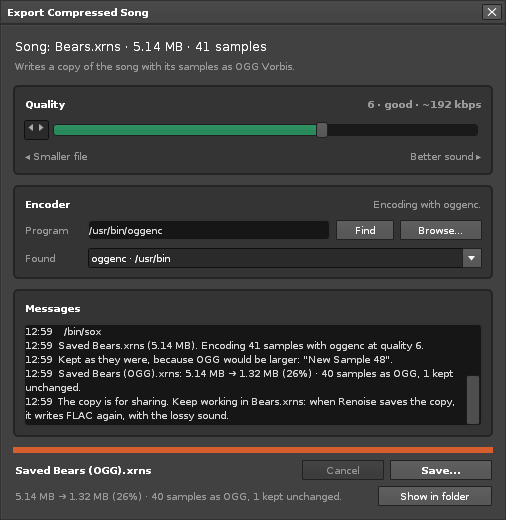

# Export Compressed Song

A [Renoise](https://www.renoise.com) tool that saves a copy of your song with
its samples as OGG Vorbis, so it is small enough to share.



*File > Export Compressed Song...* saves the open song, then writes a second
`.xrns` in which each sample is stored as OGG Vorbis instead of FLAC, whenever
that makes it smaller. Everything else in the song file is copied byte for
byte. In tests, songs came out at 15 to 26 percent of their size at quality 6.

- One quality slider (Vorbis quality -1 to 10).
- Uses an encoder you already have or install once: `oggenc`, `ffmpeg` or `sox`.
  **Find** searches the search path, the usual install folders and other
  programs that bundle `ffmpeg` (Kdenlive, Cubase, ...), and lists what it found.
- A Messages box lists what matters: the encoder found, samples kept and why,
  encoder errors in plain words.
- Renoise stays responsive: the encoder runs in the background, and the dialog
  shows progress and can cancel.
- Sample rate, length, loop points and slices survive. Samples with 24 or
  32 bits load as 16-bit samples.
- Your song stays lossless and keeps its name. The copy is for sharing: when
  Renoise saves it again, it writes FLAC with the lossy audio inside.

The user guide, which is also the page on renoise.com, is
[com.dac514.ExportCompressedSong.xrnx/README.md](com.dac514.ExportCompressedSong.xrnx/README.md).

## Install

Download the `.xrnx` from the
[releases](https://github.com/dac514/xrns-ogg/releases) and drag it onto
Renoise. Renoise 3.5 or newer (API 6.2).

## How it works

A `.xrns` file is a ZIP archive with `Song.xml` and one FLAC file per sample.
`Song.xml` does not name those files, so a sample entry can become `.ogg` with
the same base name, and Renoise loads it. No Renoise API writes OGG, so the
tool:

1. saves the song with `renoise.app():save_song()`;
2. reads the ZIP central directory in Lua (`src/zip.lua`), and matches every
   sample entry to its sample, checked against the FLAC header;
3. exports the samples as WAV and runs one job script with the encoder in the
   background, polling marker files from a timer (`src/encoder.lua`,
   `src/job.lua`);
4. writes the new archive: entries are copied as raw bytes in chunks, never
   inflated, and replaced entries are stored.

ZIP64 songs (4 GB or more) are refused with a clear message.

## Development

This project was made from [ReSlop](https://github.com/dac514/reslop). The
commands below need [just](https://github.com/casey/just), StyLua,
lua-language-server and LuaJIT; `just doctor` lists what is missing.

```
just check     # formatting + type check against the Renoise API
just test      # unit tests for the pure modules (zip, encoder, finder, song_file, labels), no Renoise needed
just install   # install into a running Renoise (enable its OSC server first)
just reload    # reinstall after an edit
just package   # dist/com.dac514.ExportCompressedSong.xrnx, without the dev bridge
```

`CLAUDE.md` is the full briefing for working on the tool, including the dev
bridge that runs Lua inside Renoise (`just eval`, `just views`, `just log`).

## License

MIT. Bundles the MIT-licensed
[renoise/definitions](https://github.com/renoise/definitions) and guide pages
from [renoise/xrnx](https://github.com/renoise/xrnx) for development; see the
`UPSTREAM.md` files.
